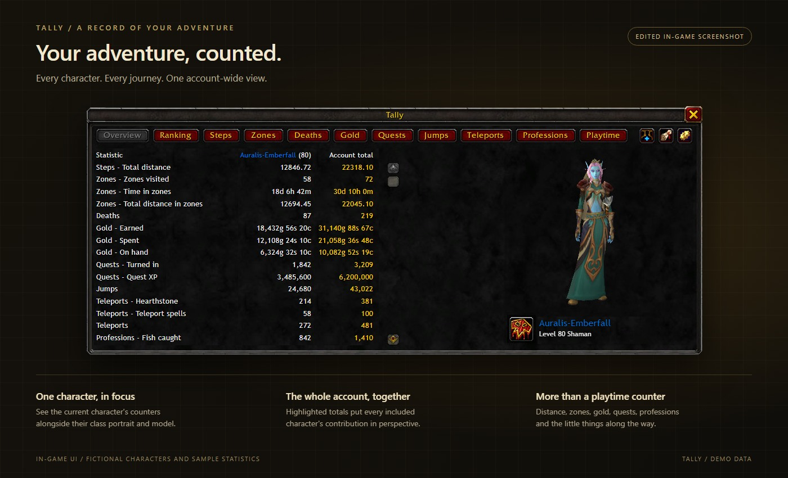
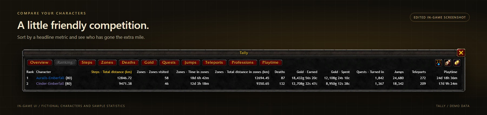
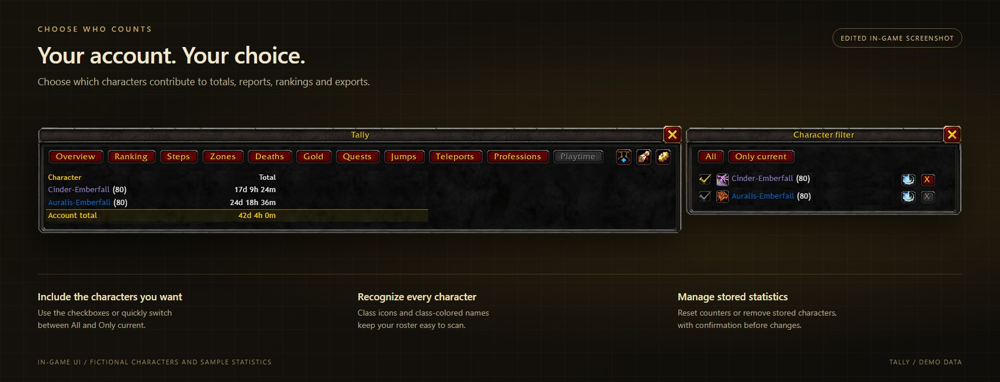
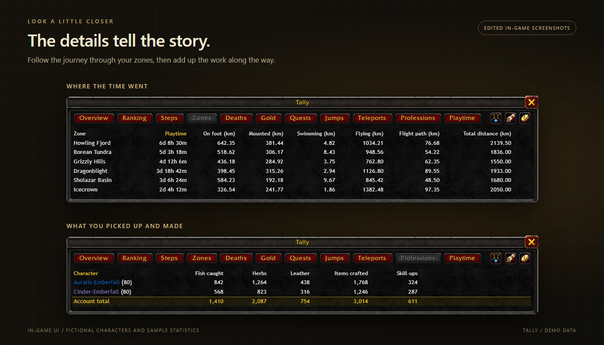

<picture>
  <source media="(prefers-color-scheme: dark)" srcset="assets/header-dark.svg">
  <source media="(prefers-color-scheme: light)" srcset="assets/header.svg">
  
</picture>

<div align="center">

[](https://github.com/SiquiL/wow-tally/releases/latest)
[](#supported-clients)
[](https://www.lua.org/manual/5.1/)
[](#translations)

[Features](#features) · [Screenshots](#screenshots) · [Installation](#installation) · [Usage](#usage) · [How it works](#how-it-works) · [Saved data](#saved-data) · [Development](#development)

</div>

Tally is a small World of Warcraft addon that keeps count of what your characters do: how far
they travel, how long they play, how often they die, how much gold passes through their hands
and more. Every counter is kept per character and summed for the whole account.

<picture>
  <source media="(prefers-color-scheme: dark)" srcset="assets/screenshots/overview-demo.jpg">
  <source media="(prefers-color-scheme: light)" srcset="assets/screenshots/overview-demo-light.jpg">
  
</picture>
<p align="center"><em>In-game UI with fictional character names and sample statistics. Images are edited for demonstration.</em></p>

## Features

| Module      | Counts                                                                                  |
| ----------- | --------------------------------------------------------------------------------------- |
| Steps       | Distance on foot in steps and km, all other movement in km                              |
| Zones       | Playtime and distance per movement mode for every visited zone                          |
| Deaths      | How often a character has died                                                          |
| Gold        | Gold earned and spent, and the balance on hand                                          |
| Quests      | Quests turned in and the quest XP gained                                                |
| Jumps       | How often a character has jumped                                                        |
| Teleports   | Hearthstone uses, toys included, and teleport spells                                    |
| Professions | Fish caught, herbs, ore and leather looted, items crafted and skill-ups                 |
| Playtime    | Time played, kept in sync with the game's `/played`                                     |

- **Overview and module tables** — the current character with a 3D model and class portrait, plus highlighted account totals in a consistent module order
- **Character ranking** — compare every included character across selected headline metrics
- **[Character filter](#choose-which-characters-count)** — identify stored characters by class icon, include or exclude them from totals, reports, rankings and exports, reset or remove them
- **Zone table** — account-wide playtime and distance per movement mode for every visited zone, excluding continent overview maps
- **Lifetime values** — deaths, quests, fishing and hearthstone uses start from the game's own statistics, playtime from `/played`
- **Milestones** — a chat message when a counter passes a threshold
- **Export** — every value as CSV or JSON, ready to copy
- **Options panel** — milestone announcements, empty-column handling, a window-position reset and a bug report link
- **Themes** — the standard look or a custom background color with automatic text contrast, plus a background opacity for every theme
- **Remembered layout** — the window keeps its position and selected view between sessions
- **Addon compartment entry** next to the minimap
- **Addon restrictions** — secret values of patch 12.0.0 are detected and skipped instead of causing Lua errors
- **English and German**, following the client language

## Screenshots

### Compare your characters

The ranking brings the included characters together in one table. Click a column heading to
compare distance, playtime, gold, quests and other headline metrics.

<picture>
  <source media="(prefers-color-scheme: dark)" srcset="assets/screenshots/ranking-demo.jpg">
  <source media="(prefers-color-scheme: light)" srcset="assets/screenshots/ranking-demo-light.jpg">
  
</picture>

### Choose which characters count

The character button in the toolbar opens a filter beside the main window. Use the
checkboxes to include or exclude stored characters, or switch quickly with **All** and
**Only current**. The selection applies to account totals, reports, rankings and exports.
Class icons help identify each character; the row buttons let you reset statistics or remove
a stored character, with confirmation.

<picture>
  <source media="(prefers-color-scheme: dark)" srcset="assets/screenshots/characters-demo.jpg">
  <source media="(prefers-color-scheme: light)" srcset="assets/screenshots/characters-demo-light.jpg">
  
</picture>

### Follow the journey and the work along the way

The zone view breaks down account-wide time and distance by movement mode. Module tabs
such as Professions show each character's contribution and the combined account total.

<picture>
  <source media="(prefers-color-scheme: dark)" srcset="assets/screenshots/modules-demo.jpg">
  <source media="(prefers-color-scheme: light)" srcset="assets/screenshots/modules-demo-light.jpg">
  
</picture>

All screenshots use fictional names and example values, not live character data.
Open an image in a new tab to view it at full size.

## Installation

1. Download the zip file from the [latest release](https://github.com/SiquiL/wow-tally/releases/latest).
2. Extract it into the `Interface\AddOns` folder of the game, e.g.
   `C:\Program Files (x86)\World of Warcraft\_retail_\Interface\AddOns`.
3. Start the game, or restart it if it is running. New addon folders are only detected on
   startup.

> [!IMPORTANT]
> The folder must be named `Tally`, like the `Tally.toc` inside it. The _Source code_ archives
> that GitHub adds to every release unpack to `wow-tally-<version>`; rename that folder to
> `Tally`.

### From source

To work on the addon, link a clone of the repository into the AddOns folder under the name
`Tally`:

```powershell
git clone https://github.com/SiquiL/wow-tally.git
New-Item -ItemType Junction `
  -Path "C:\Program Files (x86)\World of Warcraft\_retail_\Interface\AddOns\Tally" `
  -Target "$PWD\wow-tally"
```

A junction works without administrator rights, unlike `mklink /D` in an elevated command
prompt. After one restart of the client, `/reload` loads changes, unless a file is added to
`Tally.toc`.

## Usage

Every command starts with `/tally`, and `/tally help` lists them in game. Modules are addressed
by their name in lower case: `steps`, `deaths`, `gold`, `quests`, `jumps`, `teleports`,
`professions`, `played` and `zones`.

| Command                       | Description                                             |
| ----------------------------- | ------------------------------------------------------- |
| `/tally`                      | Report of every module                                  |
| `/tally <module>`             | Report of one module, e.g. `/tally steps`               |
| `/tally all`                  | Every character per module, plus the account total      |
| `/tally window [module]`      | Table with one row per character and one tab per module |
| `/tally export [csv\|json]`   | Copyable export of every value                          |
| `/tally <module> reset`       | Reset the module for the current character              |
| `/tally <module> reset all`   | Reset the module for every character (asks to confirm)  |
| `/tally chars`                | List the stored characters                              |
| `/tally remove <Name-Realm>`  | Delete a stored character (asks to confirm)             |
| `/tally milestones [on\|off]` | Turn milestone announcements on or off                  |
| `/tally options`              | Open the options panel                                  |
| `/tally debug [module]`       | Stored state: versions, character key, raw values       |
| `/tally <module> debug`       | Same as `/tally debug <module>`                         |
| `/tally ids [text]`           | Check the configured IDs, or search the game statistics |
| `/tally help`                 | List all commands                                       |

Resetting one module never touches another, and anything after `reset` other than `all` only
prints the usage. The character you are logged in with cannot be removed.

Every row of the character filter also has a reset button that clears all statistics of that
character at once, including the character you are logged in with. Both reset and remove ask
for confirmation first.

The window refreshes every second, sizes itself to the active table, scrolls long tables,
can be dragged and closes with Escape. Its toolbar opens the character filter, export and
options. Filter and export windows dock beside the main window. The export text is selected
automatically, so it can be copied right away. The addon compartment next to the minimap has
an entry as well: left-click toggles the window, right-click opens the options.

The options panel starts with the appearance. **Theme** switches between _Standard_ and
_Custom color_; **Background color** opens the game's color picker for the custom color, and
the text switches to dark colors on a light background. **Background opacity** fades the
backgrounds of every Tally window in either theme, while text, borders and the title bar stay
opaque. All three apply to every character.

**Report a bug** opens a small window with the address for a new GitHub issue, already
selected for `Ctrl+C`.

The options panel ends with a **Links** section. It shows a GitHub button and the address of
the project page. Clicking either one selects the address, so the link can be copied with
`Ctrl+C` and pasted into a browser. The game has no API that lets an addon open a browser, so
every addon that offers a link does it this way; the box is read-only and restores the address
after an edit.

> [!NOTE]
> Builds before 1.0.0 had the shortcuts `/steps` and `/deaths`. They are gone; use
> `/tally steps` and `/tally deaths` instead.

### Example output

```
Tally: Steps – Auralis-Emberfall, step length 0.75 m
  On foot: 12,480 steps (9.36 km)
  Mounted: 2.40 km
  Swimming: 0.14 km
  Total distance: 11.90 km
  Account total: 30.75 km
  Fun fact: the account has covered 72% of a marathon.
Tally: Deaths – Auralis-Emberfall
  Deaths: 7
  Account total: 19
```

## How it works

Tally only uses the in-game Lua API; [docs/API.md](docs/API.md) lists every function and event
it relies on, with sources.

### Steps

There is no step API in World of Warcraft, so distance has to be derived.

Every rendered frame the addon reads `GetUnitSpeed("player")`, which returns the current
movement speed in yards per second, and adds `speed * elapsed` to the counter of the
currently active movement mode. The mode itself is re-checked every 0.1 seconds. Integrating
speed over time was chosen over comparing map coordinates because it also works inside
instances, needs no map-to-yard conversion, and does not produce false readings on
teleports, portals or hearthstones (speed is zero during loading screens).

While skyriding, `GetUnitSpeed` does not report the actual speed. As long as
`C_PlayerInfo.GetGlidingInfo()` reports gliding, its forward speed is used instead and the
distance counts as flying.

Distances are stored as raw yards. Meters, kilometers and steps are only computed when the
report is printed, so changing a step length later corrects the numbers retroactively.

- `1 yard = 0.9144 m`
- `steps = meters / step length`

| Mode        | Condition                                               |
| ----------- | ------------------------------------------------------- |
| Flight path | `UnitOnTaxi("player")`                                  |
| Swimming    | `IsSwimming()` — takes priority over flying and mounted |
| Flying      | `IsFlying()`, or gliding while skyriding                |
| Mounted     | `IsMounted()`                                           |
| On foot     | everything else                                         |

Only walking is counted in steps; mounted, swimming, flying and flight path distances are
shown in kilometers only, and the total distance is the sum of all modes in kilometers. Flying
and flight paths are only listed once they are non-zero.

In the Steps window, distance units are part of the column headers, e.g.
`On foot (steps / km)` or `Mounted (km)`, and the cells contain the numbers only.

The step length is looked up from the character's race via `UnitRace("player")` and ranges
from 0.55 m (Gnome, Goblin, Mechagnome, Vulpera) to 0.95 m (Tauren, Kul Tiran). Unknown
races fall back to 0.75 m. Female characters get a factor of 0.96. The table lives in
`Data.lua` and can be adjusted freely. Keys are the locale-independent `raceFile` values,
so Undead is listed as `Scourge` and Haranir as `Harronir`.

The report ends with a fun fact that compares the account's total distance with real-world
reference distances from `Data.lua`.

#### Secret values (patch 12.0.0+)

`GetUnitSpeed` is flagged `SecretWhenUnitStatsRestricted`, meaning it can return a _secret
value_ while combat, encounter, Mythic+ or PvP addon restrictions are active. Performing
arithmetic on a secret value raises an immediate Lua error, so the addon checks
`issecretvalue(speed)` and adds the elapsed time to a separate "not measurable" counter
instead. That counter also runs while standing still under restrictions, so it is an upper
bound for the lost movement time.

This can be tested with `/console addonCombatRestrictionsForced 1` (reset with `0`). The
other restrictions have matching variables: `addonEncounterRestrictionsForced`,
`addonChallengeModeRestrictionsForced`, `addonPvPMatchRestrictionsForced`,
`addonMapRestrictionsForced` and `addonChatRestrictionsForced`.

### Zones

Tally stores playtime and movement distance by the current `uiMapID`. Inside instances it
uses the instance ID from `GetInstanceInfo` instead, stored as a negative key so it never
collides with a map ID. That way classic dungeons, which have no map of their own, are
counted too, and every floor and difficulty of an instance ends up in one row. Zone changes
are detected through the zone events and `PLAYER_ENTERING_WORLD`, with a five-second check
as a fallback. Distance comes
from the same validated speed tick as the Steps module, so totals use identical movement
modes and do not measure secret speed values.

The Zones tab combines data from every character enabled in the character filter. It shows
playtime, distance on foot, mounted, swimming, flying and flight paths, plus the total
distance for each zone. Empty movement columns follow the **Hide empty columns** option.
Dungeon, raid, battleground, arena and scenario maps are marked next to the zone name.
World and continent overview maps are hidden by their map type, so this works in every
client regardless of its map IDs.

### Deaths

A death is counted on `PLAYER_DEAD`. A state flag keeps one death from being counted twice:

- it starts out as `UnitIsDeadOrGhost("player")` on login, so logging in or reloading while
  dead does not count again
- it is only cleared on `PLAYER_ALIVE` or `PLAYER_UNGHOST` **if** the player is no longer
  dead or a ghost — `PLAYER_ALIVE` also fires when releasing the spirit, at which point the
  player is still a ghost

Deaths from before the installation are taken from the game's statistics, see
[Lifetime values](#lifetime-values).

### Other modules

- **Gold** — on every `PLAYER_MONEY`, the difference to the previous `GetMoney()` counts as
  earned or spent. Counting starts at `PLAYER_ENTERING_WORLD`. Mail, trades and the auction
  house count like any other change; transfers to and from the warband bank do not.
- **Quests** — `QUEST_TURNED_IN`, together with the XP reward.
- **Jumps** — `hooksecurefunc("JumpOrAscendStart")`. Skipped while swimming or flying;
  pressing jump again in mid-air counts as well.
- **Teleports** — `UNIT_SPELLCAST_SUCCEEDED` for the player, matched against the IDs in
  `Data.lua`: the hearthstone, hearthstone toys, the Garrison and Dalaran hearthstones, mage
  teleports, Astral Recall, Death Gate, Dreamwalk, Teleport: Moonglade and Zen Pilgrimage.
  `/tally debug teleports` shows the last spells that matched neither list.
- **Professions**
  - Fish: `LOOT_OPENED` together with `IsFishingLoot()`; every fishing loot counts, junk
    included.
  - Herbs, ore and stone, leather: trade goods of these subclasses according to
    `C_Item.GetItemInfoInstant()`, from every loot window, so creatures and containers count
    as well. A slot counts with its quantity on `LOOT_SLOT_CLEARED`, i.e. once it was looted.
  - Items crafted: the quantity of each `TRADE_SKILL_ITEM_CRAFTED_RESULT`.
  - Skill-ups: the levels from `GetProfessionInfo()`, compared on `SKILL_LINES_CHANGED`. The
    first level seen for a profession is only the baseline.
- **Playtime** — five seconds after login Tally asks for the `/played` value with
  `RequestTimePlayed()` and stores the answer from `TIME_PLAYED_MSG`. The chat frames skip that
  one answer, so it is not printed; in combat the request is left out. Until the next answer the
  logged-in character counts on with `GetTime()`, and the session is added on logout. Typing
  `/played` updates the value as well.

### Lifetime values

The game keeps its own statistics, also from before Tally was installed. A few seconds after
the first login of a character, Tally raises these counters to the matching statistic if
that is higher:

| Module        | Field    | Statistic                    |
| ------------- | -------- | ---------------------------- |
| `deaths`      | `count`  | Total deaths                 |
| `quests`      | `count`  | Quests completed             |
| `professions` | `fish`   | Fish and other things caught |
| `teleports`   | `hearth` | Number of times hearthed     |

This happens once per character and module; after a reset the counter starts at 0 and is not
filled in again. Milestones that the imported value has already passed are not announced. If
a statistic is not available yet, the next login tries again. The statistic IDs are in
`Data.lua` and can be checked with `/tally ids`.

Playtime needs no statistic: every login replaces it with the value of `/played`, so it covers
the time before the installation and is filled in again after a reset. Milestones that the
first value has already passed are not announced either.

### Milestones

A module can declare thresholds for one of its report values. A ticker checks them every
5 seconds and announces the highest newly reached threshold in the chat. Existing data does
not trigger one message per old threshold. Resetting a module clears its milestones, so they
are announced again. `/tally milestones off` or the options panel silences them.

## Saved data

Everything is stored account-wide in `TallyDB` under
`WTF\Account\<ACCOUNT>\SavedVariables\Tally.lua`, keyed by `Name-Realm`:

```lua
TallyDB = {
	version = 3,
	settings = {
		milestones = true,
		hideEmpty = true,
		hidden = {},
		view = "overview",
		window = { point = "CENTER", relativePoint = "CENTER", x = 0, y = 0 },
		theme = "standard",                -- or "custom"
		backgroundColor = { 0.08, 0.08, 0.08 }, -- optional, used by the custom theme
		backgroundOpacity = 1,             -- optional, 0 to 1
	},
	chars = {
		["Name-Realm"] = {
			race = "Scourge", sex = 2, class = "ROGUE", level = 90, lastSeen = 1760000000,
			steps = { foot = 0, mount = 0, swim = 0, flight = 0, taxi = 0, blind = 0 },   -- yards, seconds
			zones = {
				[1413] = { time = 3600, f = 1250, m = 8400 },                             -- seconds, yards
				[-43] = { time = 1800, f = 900, kind = "party", name = "Wailing Caverns" }, -- instance ID 43
			},
			deaths = { count = 0, seeded = true },
			gold = { earned = 0, spent = 0, current = 0 },                                -- copper
			milestones = { ["steps.total"] = 10 },
			-- and one table for each other module
		},
	},
}
```

`version` is the version of the stored data layout, 3 as of Tally 1.2.0; data from earlier
builds is converted when the addon loads. Zone distances use the sparse keys `f` (foot),
`m` (mounted), `s` (swimming), `a` (air/flying) and `t` (taxi), and only modes with data are
written. `seeded` marks a module whose counter was raised to the game's statistic. The file
is named after the addon folder, which is one more reason the folder has to stay `Tally`.

> [!WARNING]
> The client only writes that file on `/reload`, when logging out to the character screen and
> when quitting the game. A crash or a killed process discards everything since the last
> write. `lastSeen` is stamped on logout and printed by `/tally debug` — if it is older than
> your last session, the write never happened.

Each client flavor has its own `WTF` directory, so retail and Forever do not share their
totals.

## Supported clients

A single `Tally.toc` lists every supported interface version:

| Interface | Client                                   |
| --------- | ---------------------------------------- |
| 120100    | Retail / Midnight 12.1.0                 |
| 120105    | Retail / Midnight 12.1.5 (PTR)           |
| 16001     | World of Warcraft: Forever 1.60.1 (beta) |

Classic clients are not supported. Client-specific files such as `Tally_Standard.toc` are not
needed: the `_Standard` suffix is only recognised from 12.1.5 on, and comma-separated
interface versions are the recommended way to support several clients.

> [!TIP]
> If a client reports the addon as out of date, run `/dump select(4, GetBuildInfo())` in game
> and add that number to `## Interface` in `Tally.toc`.

## Limitations

- Distance is not measured while combat/encounter restrictions make `GetUnitSpeed` secret;
  that time is only counted in the "not measurable" entry.
- Step lengths are estimates, not values taken from the game files.
- Steps, jumps, gold, teleport spells, materials, crafted items and skill-ups start at 0 on
  installation; deaths, quests, fishing and hearthstone uses start from the game's statistics,
  playtime from `/played`.
- Skill-ups are read from the professions book, which shows one expansion tier per
  profession; skill-ups in older tiers are not counted.
- The playtime of other characters is as of their last logout.
- Combat Log events are no longer available to addons since patch 12.0.0, so kills and
  the killer behind a death are not tracked.
- Very wide tables have no horizontal scroll bar; the window sizes itself to their columns.
- Output is available in English and German only.
- There is no minimap button; the addon compartment entry and the options panel replace it.
- Spells, toys and statistics that do not exist on a client are never counted. `/tally ids`
  marks such spells and statistics as invalid and lists such toys as not loaded.

## Development

### Project layout

| File                      | Contents                                                                             |
| ------------------------- | ------------------------------------------------------------------------------------ |
| `Tally.toc`               | Metadata, saved variables and load order                                             |
| `Core.lua`                | Module registry, database and migration, events, `/tally`, ID check, lifetime values |
| `Data.lua`                | Step lengths, spell, item and statistic IDs, distance facts                          |
| `Milestones.lua`          | Milestone check and `/tally milestones`                                              |
| `Appearance.lua`          | Themes, background color and opacity of the windows                                  |
| `UI.lua`                  | Window and its helper                                                                |
| `Export.lua`              | CSV and JSON export                                                                  |
| `Settings.lua`            | Options panel, bug report window, `/tally options`, addon compartment                |
| `Settings.xml`            | Template for the link row of the options panel                                       |
| `textures\GitHubMark.tga` | GitHub mark shown in the options panel                                                |
| `locales\enUS.lua`        | Translation table; the English text is the key                                       |
| `locales\deDE.lua`        | German translation                                                                   |
| `modules\Steps.lua`       | Distance tracking and step report                                                    |
| `modules\Zones.lua`       | Playtime and movement distance per zone                                              |
| `modules\Deaths.lua`      | Death counter                                                                        |
| `modules\Gold.lua`        | Gold earned, spent and on hand                                                       |
| `modules\Quests.lua`      | Quests turned in and quest XP                                                        |
| `modules\Jumps.lua`       | Jump counter                                                                         |
| `modules\Teleports.lua`   | Hearthstones and teleport spells                                                     |
| `modules\Professions.lua` | Fishing, materials, crafting and skill-ups                                           |
| `modules\Played.lua`      | Playtime from `/played`                                                              |
| `docs\API.md`             | Every game API the addon uses, with sources                                          |
| `assets\header.svg`       | README header for the light theme                                                    |
| `assets\header-dark.svg`  | README header for the dark theme                                                     |
| `.luacheckrc`             | Configuration for `luacheck`                                                         |

### Adding a module

A module is one file under `modules\` that registers a table with the core and is listed in
`Tally.toc`:

```lua
local _, ns = ...
local L = ns.L

local module = {
	label = L["Example"],
	defaults = { value = 0 },             -- per-character fields, created automatically
	keepOnReset = { value = true },       -- optional, fields that reset leaves alone
	events = { "SOME_EVENT" },            -- optional, handled by module:OnEvent(event, ...)
	unitEvents = { UNIT_X = "player" },   -- optional, delivered for that unit only
	seed = { value = "example" },         -- optional, raised once to ns.STATISTICS.example
	milestones = {                        -- optional
		{ key = "value", thresholds = { 10, 100 }, text = L["%s examples"] },
	},
}

function module:OnNew(section) end        -- optional, first login with this module
function module:OnLogin(section) end      -- section is this character's data for the module
function module:OnLogout(section) end     -- optional
function module:Debug(section) end        -- optional, extra lines for /tally debug
function module:Subtitle(charData) end    -- optional, appended to the report heading
function module:ReportExtra() end         -- optional, printed after the report
function module:BuildView() end           -- optional, custom table model for the module tab

-- Required. Entries drive the report, /tally all, the window, the export and milestones.
function module:Summary(charData)
	return {
		{ key = "value", label = L["Value"], value = charData.example.value, total = true },
		-- optional per entry: value2, unit, unit2, fmt(value, value2) -> text, extra,
		-- cell(value, value2) -> text for the window, headerUnit shown in the column header,
		-- optional = true hides the entry while it is zero
	}
end

ns.RegisterModule("example", module)
```

The core owns the database, the character record, event dispatch and the single `/tally`
command. Every hook is called through `pcall`, so an error in one module is reported once
and does not stop the others. `reset` restores `defaults` except the fields in
`keepOnReset`. Module keys must not clash with an existing command (`help`, `debug`, `all`,
`chars`, `remove`, `window`, `export`, `milestones`, `options`, `ids`).
Data for a module lives under `TallyDB.chars["Name-Realm"].<key>`. Visible text goes through
`ns.L` (see [Translations](#translations)).

### Translations

The English text is the key of `ns.L`, so anything without a translation is shown in English.
`locales\deDE.lua` returns early on clients that are not German. Commands, module keys and
export fields are not translated. Another language is a copy of that file with its own locale
check, listed in `Tally.toc` next to `locales\deDE.lua`.

### Static checks

[docs/API.md](docs/API.md) lists every game API and event the addon relies on, with links and
the client versions they were checked against. Static checks run with
[luacheck](https://github.com/lunarmodules/luacheck) from the addon folder:

```powershell
luacheck .
```

### Releasing

Raise `## Version` in `Tally.toc` and commit. Then tag that commit and build a zip whose top
folder is `Tally`, so it can be extracted into `Interface\AddOns` as it is:

```powershell
git tag v1.3.0
git push origin main v1.3.0
git archive --format zip --prefix Tally/ --output Tally-1.3.0.zip v1.3.0
```

Create the GitHub release from that tag and attach `Tally-1.3.0.zip`. The release badge at
the top of this file follows the newest release on its own.

`.gitattributes` marks everything the game does not load (README, `docs`, documentation
`assets` and the tool configuration) as `export-ignore`. Runtime files such as `textures`
remain in both this zip and the _Source code_ archives that GitHub generates.
